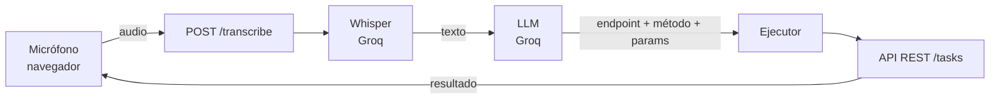

[English](README.md) | Español

# Voice Command API

Gestiona una lista de tareas con la voz. El navegador graba una instrucción hablada (hasta 20 segundos), el backend la transcribe con Whisper, un modelo de lenguaje la convierte en una llamada a la API REST de tareas y el resultado vuelve a la pantalla.

> "Crea una tarea para comprar leche" → `POST /tasks {"title": "comprar leche"}` → tarea creada.

Proyecto del **bootcamp de AI Engineering de 4Geeks Academy**. El frontend venía con la plantilla inicial; todo el backend es implementación mía.

## Cómo funciona



1. **Transcripción:** el audio va a `whisper-large-v3-turbo` en Groq. El idioma se puede fijar (`es`, `en`…) o detectar automáticamente.
2. **Interpretación:** un LLM (`openai/gpt-oss-20b` por defecto) recibe la transcripción y un prompt de sistema que describe la API, y tiene que responder con un JSON estricto: `{"endpoint", "method", "params"}`. Temperatura 0 y modo de salida JSON.
3. **Validación y ejecución:** el JSON se valida con Pydantic antes de ejecutar nada, y el ejecutor llama a las rutas `/tasks` existentes. Si la instrucción no encaja con ninguna operación, el modelo devuelve un error en lugar de inventar.
4. **Respuesta:** el frontend muestra la transcripción, la instrucción interpretada y el resultado. Los errores también incluyen la transcripción, para facilitar la depuración.

## Endpoints

| Método y ruta | Qué hace |
|---|---|
| `POST /transcribe` | Flujo completo: audio (multipart, campo `file`) o texto (JSON `{"transcription"}`) → instrucción → ejecución |
| `POST /instruction` | Solo texto → la llamada a la API interpretada, sin ejecutarla |
| `GET /tasks` | Lista las tareas |
| `POST /tasks` | Crea una tarea |
| `PUT /tasks/{id}` | Sustituye una tarea |
| `PATCH /tasks/{id}` | Actualiza parte de una tarea (título o estado) |
| `DELETE /tasks/{id}` | Borra una tarea |

Las tareas se guardan en memoria: se reinician al reiniciar el servidor. Documentación interactiva en `http://127.0.0.1:8000/docs`.

## Stack

- **Backend:** Python, FastAPI, Pydantic Settings, SDK de Groq (Whisper + LLM), uv
- **Frontend:** Vite + TypeScript (plantilla inicial)

## Ejecutarlo en local

Requisitos: Python, [uv](https://docs.astral.sh/uv/), Node.js y una [clave de la API de Groq](https://console.groq.com/keys).

```bash
cp .env.example .env        # añade tu GROQ_API_KEY
uv sync
uv run uvicorn src.main:app --reload
```

En una segunda terminal:

```bash
cd frontend
cp .env.example .env
npm install
npm run dev                 # http://localhost:5173
```

| Variable | Por defecto | Uso |
|---|---|---|
| `GROQ_API_KEY` | — | Clave de la API de Groq (obligatoria) |
| `GROQ_MODEL` | `openai/gpt-oss-20b` | Modelo que interpreta la instrucción |
| `GROQ_TRANSCRIPTION_MODEL` | `whisper-large-v3-turbo` | Modelo de transcripción |
| `REQUEST_TIMEOUT_SECONDS` | `45` | Tiempo máximo de las llamadas a Groq |
| `ALLOWED_ORIGINS` | `http://localhost:5173,…` | Orígenes CORS del frontend |

## Estructura del proyecto

```text
src/app/
  main.py                     App FastAPI, CORS y routers
  api/routes/                 /transcribe, /instruction, /tasks
  services/
    transcription_service.py  Transcripción con Whisper
    instruction_service.py    Prompt + llamada al LLM → instrucción JSON
    task_executor.py          Ejecuta la instrucción contra /tasks
    task_store.py             Almacenamiento en memoria
  schemas/voice.py            Modelos Pydantic
  core/config.py              Configuración desde el entorno
frontend/                     Cliente Vite + TypeScript
```

## Autor

**Diego Reynoso Flores** · [GitHub](https://github.com/DiegoReynoso04)
