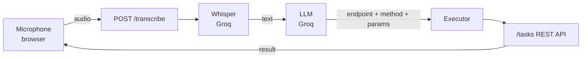

English | [Español](README.es.md)

# Voice Command API

Manage a to-do list with your voice. The browser records a spoken instruction (up to 20 seconds), the backend transcribes it with Whisper, a language model turns it into a call to the tasks REST API, and the result comes back to the screen.

> "Create a task to buy milk" → `POST /tasks {"title": "buy milk"}` → task created.

Project for the **AI Engineering bootcamp at 4Geeks Academy**. The frontend came with the starter template; the whole backend is my implementation.

## How it works



1. **Transcription:** the audio goes to `whisper-large-v3-turbo` on Groq. The language can be fixed (`es`, `en`…) or auto-detected.
2. **Interpretation:** an LLM (`openai/gpt-oss-20b` by default) receives the transcription and a system prompt describing the API, and must answer with a strict JSON object: `{"endpoint", "method", "params"}`. Temperature 0 and JSON output mode.
3. **Validation and execution:** the JSON is validated with Pydantic before running anything, and the executor calls the existing `/tasks` routes. If the instruction cannot be mapped, the model returns an error instead of guessing.
4. **Response:** the frontend shows the transcription, the interpreted instruction and the result. Errors also include the transcription, to make debugging easier.

## Endpoints

| Method and path | What it does |
|---|---|
| `POST /transcribe` | Full flow: audio (multipart, field `file`) or text (JSON `{"transcription"}`) → instruction → execution |
| `POST /instruction` | Text only → the interpreted API call, without executing it |
| `GET /tasks` | List tasks |
| `POST /tasks` | Create a task |
| `PUT /tasks/{id}` | Replace a task |
| `PATCH /tasks/{id}` | Partially update a task (title or status) |
| `DELETE /tasks/{id}` | Delete a task |

Tasks are stored in memory: they reset when the server restarts. Interactive docs at `http://127.0.0.1:8000/docs`.

## Stack

- **Backend:** Python, FastAPI, Pydantic Settings, Groq SDK (Whisper + LLM), uv
- **Frontend:** Vite + TypeScript (starter template)

## Run it locally

Requirements: Python, [uv](https://docs.astral.sh/uv/), Node.js and a [Groq API key](https://console.groq.com/keys).

```bash
cp .env.example .env        # add your GROQ_API_KEY
uv sync
uv run uvicorn src.main:app --reload
```

In a second terminal:

```bash
cd frontend
cp .env.example .env
npm install
npm run dev                 # http://localhost:5173
```

| Variable | Default | Use |
|---|---|---|
| `GROQ_API_KEY` | — | Groq API key (required) |
| `GROQ_MODEL` | `openai/gpt-oss-20b` | Model that interprets the instruction |
| `GROQ_TRANSCRIPTION_MODEL` | `whisper-large-v3-turbo` | Transcription model |
| `REQUEST_TIMEOUT_SECONDS` | `45` | Timeout for calls to Groq |
| `ALLOWED_ORIGINS` | `http://localhost:5173,…` | CORS origins of the frontend |

## Project structure

```text
src/app/
  main.py                     FastAPI app, CORS and routers
  api/routes/                 /transcribe, /instruction, /tasks
  services/
    transcription_service.py  Whisper transcription
    instruction_service.py    Prompt + LLM call → JSON instruction
    task_executor.py          Runs the instruction against /tasks
    task_store.py             In-memory storage
  schemas/voice.py            Pydantic models
  core/config.py              Settings from the environment
frontend/                     Vite + TypeScript client
```

## Author

**Diego Reynoso Flores** · [GitHub](https://github.com/DiegoReynoso04)
